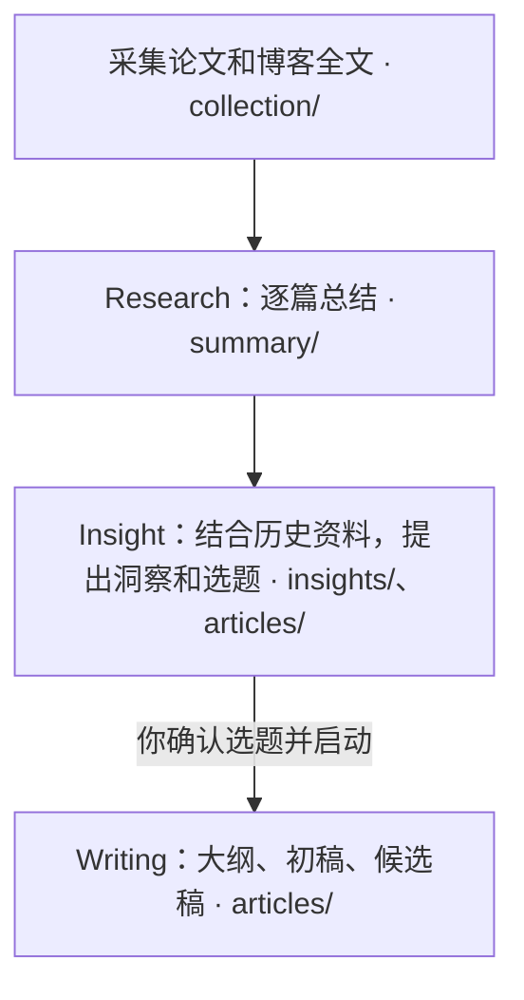

# ResearchDesk

定期自动追踪论文和博客，生成中文总结和洞察，如果希望写一些技术文章，还会推荐文章选题，用户确认后，由写作agent撰写文章。成果回存 GitHub，并且可以配置同步到 Obsidian，支持多端查看和编辑。

[快速配置](#快速配置) · [运行与阅读](#运行与阅读) · [确认选题与写作](#确认选题与写作)

## 从资料到成稿



总结和洞察经独立审阅，保留关键证据和原文链接。公众号文章可自行决定撰写与发布。

## 快速配置

在负责运行研究的 Mac 上克隆项目，进入仓库目录运行：

```sh
./setup
```

脚本准备依赖并打开本机向导。如果浏览器未打开，访问终端打印的地址。

| 步骤 | 你要做什么 | 向导做什么、如何确认成功 |
| --- | --- | --- |
| **01 研究方向** | 保留默认 **Agent Memory**，或添加、删除方向，点击「保存研究方向」 | 准备工作台和内置来源。已保存的 1–8 个方向会在下次定时任务中分别运行。 |
| **02 连接账号** | 点击「Continue with ChatGPT」授权；点击「登录 GitHub」，用「复制并跳转授权页」提交设备码 | 检查会员模型和仓库权限，复用已有有效授权。看到 ChatGPT **已授权**、GitHub **已连接**，再核对仓库名。 |
| **03 定时研究** | 勾选星期几，选时间和时区，点击「创建定时研究」 | 安装 SDK、启动 Mac 执行器、做健康检查并写入日程。看到 **已启用**、当前日程和 **GitHub Action** 链接即完成。 |
| **04 选题确认** | 定时研究启用后，点「打开选题确认页」 | 向导打开本机确认页。正式选题回存 GitHub 后，会出现在「待确认选题」。 |
| **05 Obsidian（可选）** | 使用默认路径，或点「选择路径」指定空文件夹；按需点「准备阅读库」 | 从 GitHub `main` 取出适合阅读的 Markdown。看到 **阅读库就绪** 后，在 Obsidian 将该文件夹打开为仓库。 |

健康检查不调用模型，首次研究在下一次实际触发时开始。向导可以关闭，执行时 Mac 需开机、联网、未休眠，且执行器在线。

<details>
<summary>GitHub 仓库和授权要求</summary>

目标仓库需要由你管理，默认分支 `main` 已包含本版本工作流，并允许 Actions、自托管执行器和成果回存。符合条件的公开上游副本可在向导中「创建私有 GitHub 仓库」。已有 GitHub 登录但缺少更新工作流的 `workflow` 权限时，点「补充授权」。

</details>

## 本机运行诊断台

Fork 后将自己的仓库克隆到本机，在仓库根目录执行：

```sh
./diagnose
```

需要 Python 3.7 或更新版本，仅使用标准库。命令自动在默认浏览器打开 <http://127.0.0.1:8765/>。诊断台免登录，只监听本机；无需先运行 `./setup`。终端按 Ctrl+C 停止服务。仓库按钮根据本地 Git 的 `origin` 指向自己的 GitHub fork。

用「新增运行」开始记录，或导入原诊断台导出的 JSON 备份。数据按浏览器、端口和仓库保存。迁移电脑、浏览器或端口前，可从「运行档案」导出备份。诊断台只记录证据和恢复计划，验证命令由用户在对应仓库手动执行。

端口冲突时可用 `./diagnose --port 8876`。无图形环境可用 `./diagnose --no-browser`。如需在任意目录直接输入 `diagnose`，可以把仓库根目录下的 `diagnose` 符号链接到自己的 PATH 目录。

## 运行与阅读

**查看运行。** 点击向导中的「GitHub Action」。在运行详情查看 `save-checkpoints` 是否回存成果、`refresh-obsidian` 是否刷新阅读库。到点未运行时，到仓库 **Settings → Actions → Runners** 检查 Mac 是否在线。

**手动运行。** 在同一工作流点 **Run workflow**，选择 `main`，再选操作：

| 操作 | 用途 |
| --- | --- |
| `health` | 默认。检查授权、模型和环境，无模型调用 |
| `collect` | 只采集并归档原文 |
| `run` | 采集、总结、综合洞察。留空 `cycle_id` 时新建手动批次 |
| `catchup` | 补跑。填原 `cycle_id` 可继续指定批次，复用已完成的检查点 |

**阅读同步。** `GitHub main → Mac 阅读库 → 其他设备`。执行器在线时会把成果和阅读资料更新同步到本机 Vault。多端阅读由 Mac 上运行的 Obsidian Sync 接力，其他设备连接同一个远程 Vault。 [Obsidian Sync 设置指南](https://obsidian.md/help/sync/setup)

## 确认选题与写作

在向导第 04 步点「打开选题确认页」。选中正式选题后，核对证据、调整写作要求并点「保存写作确认」。确认同步到 GitHub 后，在「确认记录」点「开始测试写作」。回存后的稿件和审阅意见也可在「确认记录」查看。

## 进一步设置

重开 `./setup` 可修改方向、日程和阅读库路径。来源、模型、文风及用量可在本机 `config/local/workbench.yaml` 调整，默认每月共享 100 次模型调用。

[配置与迁移](workflows/workbench-init.md) · [执行器排查](workflows/self-hosted-worker.md) · [研究与写作命令](workflows/README.md)
