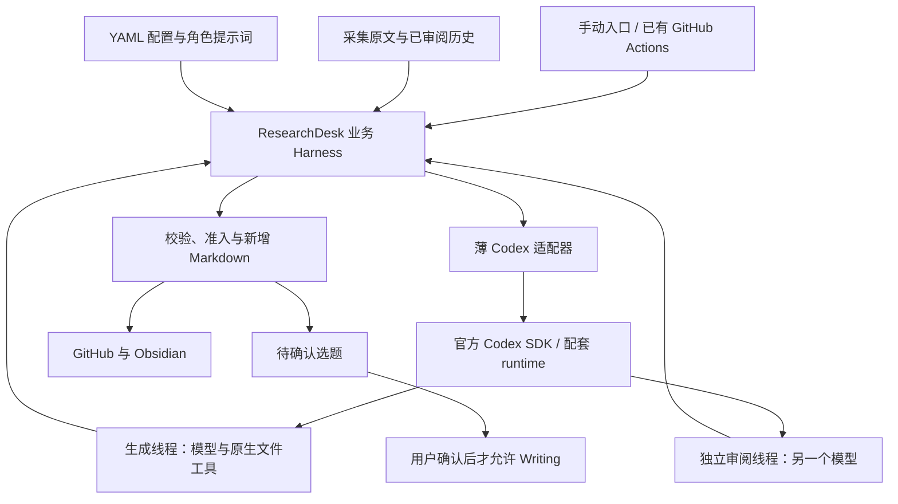

# Codex 后端与 ResearchDesk Harness 技术方案

状态：待实施。基线日期：2026-11-01。本方案不切换现有后端、不调用模型、不启用定时任务。

目标是让 Research、Insight、Writing 复用官方 Codex 的读文件、检索、工具调用循环与会话管理，同时保留 ResearchDesk 的资料规范、独立审阅、人工确认、预算和入库规则。先接通 Insight，再迁移 Research 与 Writing。

## 1. Harness 的职责划分

Harness 是围绕模型组织上下文、工具、权限和执行状态的运行环境。这里分两层：Codex 负责一次 Agent 任务内部怎样使用工具完成工作；ResearchDesk 负责这项工作何时开始、允许读什么、结果怎样审阅和保存。



| 部分 | 负责的工作 |
| --- | --- |
| Codex runtime | 模型推理与工具结果的往返、原生文件读取和搜索、会话上下文与运行事件 |
| 薄适配器 | 启动和配置 runtime、传入官方授权、把官方任务与事件转换成项目协议、恢复和中断 |
| ResearchDesk 业务 Harness | 验证资料、固定输入、生成任务、独立审阅、一次修订、账本、人工确认、结果准入 |
| 既有外围工具 | 采集和 URL/arXiv/DOI 去重、执行主机、Git 回存、选题页面和 Obsidian 同步 |

三 Agent 是三种角色与业务阶段，共用一个 Codex 后端；首期按顺序执行。独立审阅是每个阶段的质量关卡。ResearchDesk 不再实现一套 `模型 → tool_calls → 执行工具 → 回传模型` 循环，也不增加常驻 Agent 服务、数据库、向量库或新的任务队列。

## 2. 当前实现与需要替换的边界

现有 [membership 客户端](../scripts/researchdesk_membership.py) 已支持 ResearchDesk 自己的 ChatGPT 官方授权、刷新及 Responses 流式调用，但 `infer()` 主要返回文本，没有承载完整 Agent 工具循环。

| 现有位置 | 迁移方式 |
| --- | --- |
| [researchdesk_membership.py](../scripts/researchdesk_membership.py) | 保留本应用 SIWC 授权与刷新；Codex 推理由新适配器承接 |
| [researchdesk_batch.py](../scripts/researchdesk_batch.py)、[researchdesk_insight.py](../scripts/researchdesk_insight.py) | 复用业务提示词、校验、笔记保护和渲染；新路径按任务执行，保留旧单请求路径 |
| [researchdesk_insight_inputs.py](../scripts/researchdesk_insight_inputs.py)、[researchdesk_cycle_discovery.py](../scripts/researchdesk_cycle_discovery.py) | 接入新 `summary` 与关联 `collection`，移除新 Insight 路径的字符预算和固定历史篇数截断 |
| [researchdesk_research.py](../scripts/researchdesk_research.py) | 继续消费采集回执，按单篇生成已审阅总结；后续只替换内部执行后端 |
| [researchdesk_runner.py](../scripts/researchdesk_runner.py)、[researchdesk_job.py](../scripts/researchdesk_job.py) | 保留本地/远程主机与回存机制，显式扩展新结果和证明文件的导出允许清单 |

新增 `backend: codex`，与现有 `chatgpt_plan` 分开。不能把一个多轮 Codex 任务直接塞进 `infer()`，继续记成“一次模型调用”；也不能伪造旧 `official_chatgpt_oauth` 回执以通过现有校验。

当前代码还存在 `max_input_chars`、历史 `max_documents`、Insight 仅 1–2 条等限制。本方案要求在新路径中同步修改提示词、配置验证、输入选择、结果验证、审阅和导出，不能只改提示词。旧配置本次保持原样。

## 3. 官方接口与会员授权

首选稳定版 Python 包 `openai-codex`，锁定发行版本并使用包配套的 Codex runtime。官方要求 Python 3.10 及以上；现有 Python 项目可以直接集成，无须新增 Node 服务。[官方 SDK 文档](https://learn.chatgpt.com/docs/codex-sdk)

会员路线优先复用 ResearchDesk 自己已经取得的 Sign in with ChatGPT（SIWC）授权。宿主负责刷新，将 access token 仅传给 Codex 子进程；官方支持以 `ACCESS_TOKEN` 和 Responses provider 接入，不需要另行提取 Codex 桌面端或浏览器的凭据。授权失效时停止，不回退到 API Key 计费。[官方 SIWC 接入说明](https://developers.openai.com/siwc/token-sharing-open-source/codex-app-server)

实施前先验证锁定 SDK 是否能通过公开接口表达 provider、子进程环境、权限、事件订阅和状态恢复。官方 Python 页面没有给出这些能力全部对应的参数签名，本方案不虚构 `CodexConfig(env=...)` 等调用。先查发行包的公开类型与文档，再写最小适配代码。

初始化时还须配置稳定的 `clientInfo.name/title/version`。应用名与自身 SIWC 注册使用的 `agent_name_hint` 保持一致；现有代码的 hint 是 `ResearchDesk`，不能未经核实沿用 SDK 默认身份。公开 SDK 是否允许设置这些字段也纳入能力验证。[官方初始化要求](https://developers.openai.com/siwc/token-sharing-open-source/codex-app-server)

直接操作 `codex app-server` 的协议与命令仍有 Experimental 标记，不能因为 Python SDK 标为稳定就承诺裸协议稳定。首期不自行维护第二套 JSON-RPC 客户端；SDK 缺少必要能力时，先报告能力缺口，再决定是否明确采用锁版本的实验适配。[App-server 文档](https://learn.chatgpt.com/docs/app-server)

`model/list` 只能用于展示候选目录，不能证明会员拥有该模型。配置继续使用现有研究、洞察和审阅模型；后续获准的小额实际执行成功，才能记录该账号此次模型访问已验证。记录请求模型与 runtime 返回的模型标识/改路信息，不自行推测实际模型。

Codex 提供的是 Agent runtime，并不自动继承 ChatGPT 网页的全部工具、连接器或历史聊天。首期只开放固定资料的本地读取与搜索，联网采集继续使用现有采集模块。[会员工具限制](https://developers.openai.com/siwc/token-sharing-open-source/preview-limitations)

## 4. 最小代码组织与任务协议

只新增两个核心模块，角色提示词沿用现有来源并做必要调整：

```text
scripts/researchdesk_codex.py     # 官方 runtime 适配、能力检查与事件转换
scripts/researchdesk_harness.py   # 固定输入、阶段状态、审阅、恢复与准入
```

适配器不读取业务资料目录、不决定研究选题、不提交 Git。Harness 调用既有采集索引、预算、人工笔记保护与渲染函数，避免同时重写整个项目。

以下是项目自有协议，不是 SDK 的方法签名：

| 接口 | 行为 |
| --- | --- |
| `preflight(profile)` | 不推理；检查版本、配置、授权来源、隔离与可观测能力，返回明确缺口 |
| `start(task)` | 创建线程并执行任务，持续交付标准化事件 |
| `inspect(handle)` | 核对已知 thread/turn 的状态和已完成结果，不启动新推理 |
| `resume(handle)` | 恢复连接与已有会话；不等同重新发送任务 |
| `continue_turn(handle, task)` | 旧 turn 已明确结束后，显式预留并启动修订或续读的新 turn |
| `interrupt(handle)` | 请求停止，并分别记录“已请求”与“确认终止” |

`TaskSpec` 至少包含 `task_id`、`stage`、`phase`、`topic`、`cycle_id`、输入清单与散列、请求模型、提示词/结果 schema 版本、runtime profile，以及 Writing 所需的确认绑定。

`TaskResult` 至少包含终态、thread/turn ID、请求及可核实的实际模型、完整最终响应、资料读取记录、usage、失败类别。`RunEvent` 统一保留时间、任务/尝试 ID、事件序号、类型和经脱敏的数据。

`start`、`continue_turn` 都可能新增推理；`inspect`、`resume` 不主动发起新 turn。首次生成使用 `start`，一次修订使用生成者已完成的线程与 `continue_turn`，每次独立审阅都使用 `start` 创建新线程。

业务代码只依赖上述协议；SDK 升级造成的事件字段变化集中在适配器处理。暂不引入通用插件注册表或多厂商抽象。

## 5. 输入组织、历史阅读与工具权限

每个批次在 Vault 之外建立运行目录，例如 `~/Library/Application Support/ResearchDesk/runs/<workbench_id>/<topic>/<cycle_id>/`。工作台 ID 绑定仓库身份，输入、锁与 Codex 状态按工作台、主题和批次隔离，避免不同仓库或主题使用同一批次名时碰撞。冻结输入后，生成和审阅都绑定相同散列；历史继续增长不会改变正在执行的任务。

```text
<运行目录>/
  input/
    manifest.yaml         # 来源、日期、身份、章节、相对路径及散列
    current/              # 本批原文与已审阅总结
    history/              # 相关历史总结与所依赖的原文
  task/                   # 可信角色指令、结果 schema
  state/                  # 线程、阶段、预留、恢复状态
  candidate/              # 宿主保存的候选和审阅结果
  codex-state/            # 隔离的 runtime 状态，不同步到 Git/Obsidian
```

输入准备复用已有来源身份与散列检查；拒绝路径穿越、符号链接和未通过审阅的历史总结。原始文献作为数据处理，其内嵌指令不进入可信任务说明。模型读取冻结副本，不能回写原文、人工笔记或正式目录。

Research 按原文章节索引分析问题、方法步骤、实验设置、结果、边界和失败案例。`full_text_required` 继续有效：正文缺失时跳过或明确阻塞；HTML/PDF 抽取未包含的图表、公式和附录须记录缺口。

Insight 读取本批已审阅总结，并使用近 90–180 天同主题、相关的历史资料。按规范 URL、arXiv、DOI 合并同源版本，区分发表、更新和研究日期；旧文章近期入库不能作为新趋势证据。已审阅历史 Insight 只提供线索，关键判断仍须追溯原始来源，避免把旧推断当新事实。

**不设置 Insight 项目级输入字符/token 预算，也不按固定篇数截断相关历史。** 合格资料放入输入集合，由 Codex 使用原生文件工具按问题定位、分段读取和归纳；不把整个资料库拼成一个超长请求。实际模型上下文仍有限，需保留章节与结论对应关系，压缩后可以重新读原文。

同时记录 `available_sources`（允许访问的固定资料集合）与 `consulted_sources`（工具实际读取的文件、章节或范围）。读取事件与模型申报范围相互核对；文件可访问不证明已阅读，调用读文件也不证明充分理解。报告只声明有记录支持的阅读范围。

首期只用 Codex 原生本地文件工具，不增加自定义 MCP server、动态工具或浏览器。需要补充新原文时交回采集步骤，形成新的证据版本，不能在审阅中静默更换来源。

### 宿主隔离的实施要求

`cwd` 和 `Sandbox.read_only` 都不足以保证只能读取输入目录。锁定 runtime 后，需使用其支持的文件权限配置，将任务资料设为只读，并拒绝凭证、SSH、Git 授权、其他项目和用户私人文件；保留工具运行必需的最小系统读取范围。

官方 permission profiles 目前为 Beta，不能与旧 `sandbox_mode`/`--sandbox` 混用；选择该路线时，SDK 也不能再发送覆盖它的旧 Sandbox 设置。权限配置需针对当前 Mac 验收，远程 Linux 另做平台检查；不能满足读隔离时停止，不降级全盘权限。[官方权限说明](https://learn.chatgpt.com/docs/permissions)

Codex 进程自身需要 SIWC token 与模型服务通信，模型执行的工具子进程不应获得 token。使用最小工具环境、显式敏感变量排除、受控 shell 启动与独立 Codex 状态目录，并用无敏感值的探针验证。只过滤环境变量名称还不够，需同时防止从宿主文件和 shell 初始化配置再次读取凭证。[环境配置说明](https://learn.chatgpt.com/docs/config-file/config-advanced)

关闭模型工具的网络、MCP、连接器与非任务技能自动加载；模型客户端的授权流量单独处理。定时模式不自动批准扩权请求，出现请求即停止并记录 `waiting_approval`。

## 6. 生成、独立审阅与可读结果

一次正常 Insight 批次按以下顺序执行：

1. 验证采集与 Research 回执，固定本批和历史资料，检查模型与权限配置。
2. 为生成任务落盘预留，启动新的 Codex 线程；Codex 自行完成资料搜索、阅读与分析。
3. 宿主保存完整最终响应并做结构、来源、阅读范围和选题状态校验。
4. 启动另一个新线程，用不同审阅模型读取相同资料集合及候选；审阅不共享生成者会话或私有推理过程。
5. 通过则进入导出；需修改则向生成线程发送具体问题，最多一次修订，再由新审阅线程检查。仍不通过则保留失败结果。

请求模型必须不同；runtime 可提供的实际模型与改路信息也要核对。若无法确认独立模型身份，不能把“配置了不同字符串”写成已经验证的独立审阅。

生成结果使用一个有版本的结构化对象：`outcome`、`coverage`、可读综合文章 `report`、`insights`、待确认 `topics` 和机器证据映射。Insight 列表至少一项，不设置条数上限；合并重复观点，每条都须包含推理、来源、反例或替代解释，以及待验证问题。

审阅逐项覆盖报告、全部洞察和全部选题，不能只审前两条。趋势判断要求可追溯的跨来源、跨时间证据；同源材料不算独立验证。证据不足时写研究线索或可反驳假设；不能为了至少一条而造结论，无法形成合格洞察时返回 `insufficient_evidence`。

首期采用只读任务：最终结构化响应交给宿主保存与渲染。Markdown 正文是可直接阅读的技术文章，具体解释机制、比较与推导；来源用自然署名、少量就近链接和篇末资料列表。内部证据编号、散列、审阅清单保留在机器记录，不逐段插入正文。

物理上下文/输出限制触发时，保留未完成状态和已读范围；需要继续时作为显式、可计量的追加 turn。未完整结束、半截 JSON、缺少章节或引用目标的结果不得入库，不靠截掉洞察或静默丢弃历史解决。首期不增加自制自动分片调度器。

## 7. 状态、失败补跑与幂等导出

```text
prepared → input_frozen → generation_reserved → generation_running
→ generated → candidate_validated → review_reserved → reviewing
→ review_passed → export_planned → exported
                     ↘ needs_revision → 修订 → 新线程再审阅
```

`failed_known`、`interrupted_known`、`blocked_unknown`、`waiting_approval`、`insufficient_evidence` 是不同结果。SDK 返回文字、工具执行结束或中断请求已发出，都不等于任务成功。适配器必须以官方明确终态和完整产物为依据；app-server 对应 `turn/completed` 且状态为 `completed`。

启动前保存任务/尝试 ID、输入和指令指纹及预留；收到 thread/turn ID 立即保存。按工作台、主题和批次使用本机独占锁，防止同一主机上手动运行与 Actions 重复启动。首期每个工作台配置单一执行主机，Actions 沿用并发控制；本机锁不宣称具备跨主机分布式互斥能力。

| 中断位置 | 补跑行为 |
| --- | --- |
| 任务尚未启动 | 同 ID 继续，复用固定输入 |
| 生成或审阅已明确完成且响应完整 | 复用结果，继续下个业务阶段 |
| 连接丢失、超时或进程退出，旧 turn 状态不明 | 先 `inspect` 核对已有状态；不能直接新建 turn 重发 |
| 无法核对旧 turn、是否执行仍未知 | 标记 `blocked_unknown`，保留预留，等待明确处置 |
| 授权刷新 | 宿主刷新、重启 runtime、恢复原线程；仍先核对旧 turn |
| 审阅通过但导出中断 | 只重做校验和导出，不新增推理 |
| 输入、模型、提示词或 runtime 版本变化 | 新任务版本，不伪装成原任务续跑 |

`resume` 只恢复会话，不保证“重新发一次也不会重复消费”。模型工具首期只有只读动作，导出、Git 和其他外部副作用全部由宿主执行。

导出先保存目标文件及散列计划，以新增文件方式落盘，完成后最后写准入回执。恢复时文件与计划一致则复用；已有文件被人工修改则停止并报告冲突。正式准入绑定输入、候选、审阅模型/响应、输出散列和版本，不能仅凭 Markdown 文件存在判断通过。

## 8. 会员用量与现有 100 次上限

现有 [membership_budget.yaml](../config/membership_budget.yaml) 的 `month_max_calls: 100` 统计真实会员推理请求预留，失败或结果未知也占用。一个 Codex turn 内可能有多次模型请求，不能把它解释成 100 个 Agent 任务。

新账本需分开记录：

| 字段 | 含义 |
| --- | --- |
| `task_count` | ResearchDesk 业务任务数量 |
| `turn_count` | Codex 显式 turn 数量 |
| `model_request_count` | runtime 能可靠提供时才记录真实推理请求数，否则为未知 |
| `usage` | 官方事件提供的 token 等用量及其来源，缺失则明确未知 |
| `auth_source` / `backend` | 账号匿名绑定、授权路线与后端，避免混淆账本 |

不记录私有思维链、token 值或环境转储。旧账本继续保留，不能清零、换算或因 backend 名变化漏计共享消耗。

接入验收须确认是否能在每次内部推理前可靠预留与执行原请求上限。只有结束后的 token 汇总不能实现这件事。若 SDK 无此能力，先明确限制缺口，再由用户决定官方应用用量限制和新的本地任务/时长控制口径；不能静默降低原预算约束。能力与计量尚未确认前，只做离线闭环，不开启真实长期任务。

不设置输入预算与不限制洞察条数，不代表取消会员用量控制。授权、账号额度、限流或任务控制触发时，保留检查点并停止。

## 9. YAML 配置与成果目录

主题仍由 [research_topics.yaml](../config/research_topics.yaml) 管理。模型沿用批次 YAML；runtime 设置集中扩展现有配置体系，不引入另一套配置中心。以下是待实现的项目配置形状，当前 loader 不接受，不能直接复制运行：

```yaml
backend: codex
codex:
  driver: python_sdk
  sdk_version: "<能力验收后锁定的稳定版本>"
  runtime: bundled
  auth_source: researchdesk_siwc
  profile: research_read
models:
  research: gpt-6.1-sol
  insight: gpt-6.1-sol
  review: gpt-6-astra
insight:
  history_lookback_days: 180
  min_insights: 1
  max_revisions: 1
```

不提供 `max_input_chars`、历史篇数上限或 `max_insights`；真实模型名称以用户实际资格为准。凭据路径、令牌与 runtime 本机状态留在库外，公开配置仅包含可分享的策略。

面向读者的目录保持简单：

```text
collection/<topic>/<cycle>/...    # 采集原文
summary/<topic>/<cycle>/...       # 已审阅逐篇总结
insights/<topic>/<cycle>/report.md
articles/<topic>/<cycle>/topic-N.md
```

洞察、比较、趋势和深入研究方向组织在同一篇综合文章中；选题卡单列，待页面人工确认。Writing 继续受确认 ID、选题/证据散列和写作要求约束，生成大纲、初稿和候选稿，分别独立审阅。

首个闭环只导出到 `insights/test/<topic>/<cycle>/`、`articles/test/<topic>/<cycle>/`，脱敏证明沿用 `reports/test/<topic>/` 内部记录。正式路径仅是后续准入目标。当前不搬迁、删除或重写旧记录，也不新增研究成果。

GitHub Actions 仍负责触发和结果回存；用户授权与 Codex 在自己的 Mac 或远程 self-hosted runner 上运行。Git 凭据不进入模型工具环境，回存使用允许路径清单。GitHub 与 Obsidian 共享 Markdown；runtime 会话、凭据和原始事件不进入 Vault。

## 10. 实施顺序与验收

### 第一步：适配能力验证

锁定 SDK/runtime，核实公开配置与事件接口，验证 SIWC provider、初始化应用身份、权限边界、thread/turn 查询、最终结果和计量能力。使用假凭据与协议样例完成不推理检查，明确真实推理资格只能在获准试跑时确认。任何关键能力缺失都先形成结论，不绕过沙箱或预算。

### 第二步：Insight 离线闭环

实现两个核心模块，使用两份虚构的已审阅资料和模拟 runtime 事件，走通多次文件读取、生成、独立审阅、一次修订、检查点与仅 test 导出。同步调整历史选择及全部 Insight 校验，不限制为两条。

### 第三步：获准的小额真实 Insight

在隔离和计量方案确认后，使用两份真实、已通过 Research 审阅的资料；资料不足时先准备输入，不能把原文标成已审阅总结。验证指定生成/审阅模型和可读产物，结果只写 test。通过前保持旧后端为默认，不启用自动任务。

### 第四步：复用到 Research 与 Writing

逐篇 Research 复用同一任务协议和原文章节索引；Writing 复用同一适配器，保留页面确认与原文引用。三阶段均验收后，再决定是否收缩旧手写推理/SSE 路径；授权刷新、保护规则和恢复证明继续保留。

验收集中覆盖以下行为，不扩展成通用 Agent 测试平台：

| 场景 | 通过条件 |
| --- | --- |
| 原生工具循环 | 同一任务内多次定位/读取文件后完成；ResearchDesk 没有手写工具派发循环 |
| 隔离与授权 | 无敏感值探针证明凭证不可读、工具环境无 token、正式目录不可写；授权失败无 API Key 回退 |
| 独立审阅与条数 | 新线程、不同且可核实模型；至少三条模拟洞察全部审阅与保存，长输入不触发旧字符截断 |
| 失败与修订 | 一次修订后再审，拒绝或证据不足不导出；空输入零推理 |
| 未知结果恢复 | 断连后先核对旧 turn，未知时不创建新 turn、不假报成功 |
| 导出恢复与笔记 | 审阅完成后中断只补导出；人工修改与原文保持不变 |
| 用量与可读性 | task/turn/真实请求与 usage 不混用；正文连贯，来源可追溯，阅读范围和推断边界明确 |

实施完成后运行项目既有校验与针对新增行为的离线测试，再进行获准的小额真实验收。下一项开发工作是第一步的 SDK 能力验证和薄适配器；本技术方案本身不授予模型调用、定时启用或公众号发布权限。
