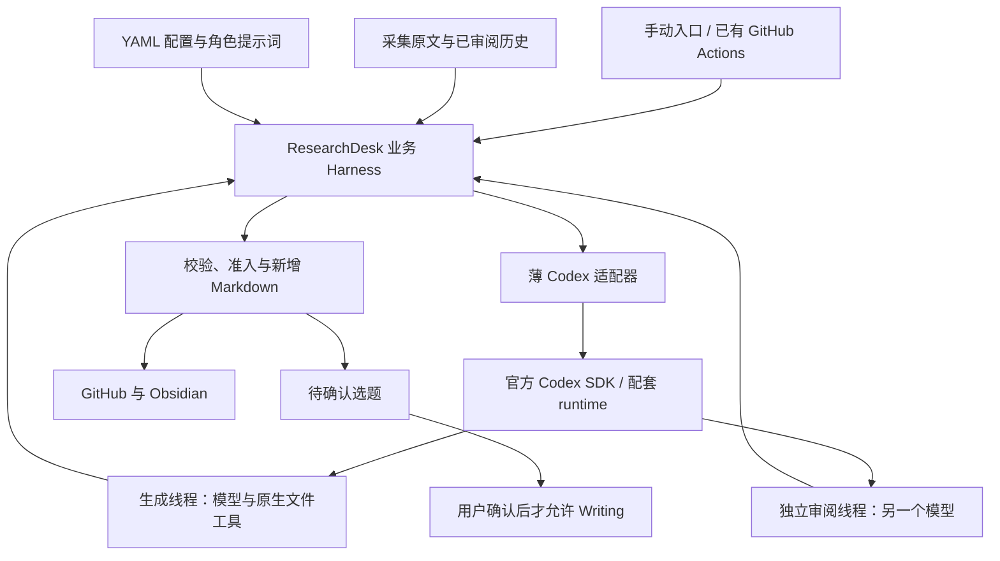

# Codex 后端与 ResearchDesk Harness 技术方案

状态：官方 SDK 已在当前 Mac 真实接通，自有会员授权、原生文件工具、独立模型审阅与逐请求预算已通过小额接入验收；完整真实资料 Insight 批次、Research/Writing 迁移待完成。基线日期：2026-11-01；内容仅做准确性校验。默认旧后端与定时开关保持不变。

已落地入口是 `scripts/researchdesk_harness.py`：`preflight` 只检查元数据，`offline-demo` 零调用演练，`sdk-smoke` 真实核对本地测试文件，`insight` 显式消费已审阅研究。运行方式见[操作说明](README.md)，实际验收及平台边界见 [SDK 核实记录](codex-sdk-capabilities.md)。

目标是让 Research、Insight、Writing 复用官方 Codex 的读文件、检索、工具调用循环与会话管理，同时保留 ResearchDesk 的资料规范、独立审阅、人工确认、预算和入库规则。先接通 Insight，再迁移 Research 与 Writing。

## 1. Harness 的职责划分

Harness 是围绕模型组织上下文、工具、权限和执行状态的运行环境。这里分两层：Codex 负责一次 Agent 任务内部怎样使用工具完成工作；ResearchDesk 负责这项工作何时开始、允许读什么、结果怎样审阅和保存。



| 部分 | 负责的工作 |
| --- | --- |
| Codex runtime | 模型推理与工具结果的往返、原生文件读取和搜索、会话上下文与运行事件 |
| 薄适配器 | 启动和配置 runtime、传入官方授权、把官方任务与事件转换成项目协议、恢复和中断 |
| ResearchDesk 业务 Harness | 验证资料、固定输入、生成任务、独立审阅、一次修订、账本、人工确认、结果准入 |
| 既有外围工具 | 采集和 URL/arXiv/DOI 去重、执行主机、Git 回存、选题页面和 Obsidian 同步 |

三 Agent 是三种角色与业务阶段，共用一个 Codex 后端；首期按顺序执行。独立审阅只核对内容准确性。ResearchDesk 不再实现一套 `模型 → tool_calls → 执行工具 → 回传模型` 循环，也不增加常驻 Agent 服务、数据库、向量库或新的任务队列。

准确性检查针对事实、来源和结论是否超出证据。可读性、深度、标题、字数和结构通过生成提示词引导，不增加评分、合格线或额外润色审阅。原有授权、用量、人工确认与文件保护仍由程序执行，不交给审阅模型重复确认。

## 2. 当前实现与需要替换的边界

现有 [membership 客户端](../scripts/researchdesk_membership.py) 已支持 ResearchDesk 自己的 ChatGPT 官方授权、刷新及 Responses 流式调用，但 `infer()` 主要返回文本，没有承载完整 Agent 工具循环。

| 现有位置 | 迁移方式 |
| --- | --- |
| [researchdesk_membership.py](../scripts/researchdesk_membership.py) | 保留本应用 SIWC 授权与刷新；Codex 推理由新适配器承接 |
| [researchdesk_batch.py](../scripts/researchdesk_batch.py)、[researchdesk_insight.py](../scripts/researchdesk_insight.py) | 复用准确性提示、笔记保护和渲染；新路径按任务执行，收缩旧结构与格式准入规则，保留旧单请求路径 |
| [researchdesk_insight_inputs.py](../scripts/researchdesk_insight_inputs.py)、[researchdesk_cycle_discovery.py](../scripts/researchdesk_cycle_discovery.py) | 接入新 `summary` 与关联 `collection`，移除新 Insight 路径的字符预算和固定历史篇数截断 |
| [researchdesk_research.py](../scripts/researchdesk_research.py) | 继续消费采集回执，按单篇生成已审阅总结；后续只替换内部执行后端 |
| [researchdesk_runner.py](../scripts/researchdesk_runner.py)、[researchdesk_job.py](../scripts/researchdesk_job.py) | 保留本地/远程主机与回存机制，显式扩展新结果和证明文件的导出允许清单 |

新增 `backend: codex`，与现有 `chatgpt_plan` 分开。不能把一个多轮 Codex 任务直接塞进 `infer()`，继续记成“一次模型调用”；也不能伪造旧 `official_chatgpt_oauth` 回执以通过现有校验。

旧代码还存在 `max_input_chars`、历史 `max_documents`、Insight 仅 1–2 条等限制。新路径已在输入选择、生成提示词、结果与审阅处理、导出中取消这些机械限制；旧配置和历史路径保持原样。

新路径不直接沿用旧校验器的“比较必须 3–6 条”“每条洞察必须同时引用新旧资料”“固定字段必须完全一致”和逐项审阅确认表。保留来源与内容核对；章节数、来源数、历史是否为空等不能单独触发拒收。当前改动只用于显式新入口，不重解释旧模型回执。

## 3. 官方接口与会员授权

首选稳定版 Python 包 `openai-codex`，锁定发行版本并使用包配套的 Codex runtime。官方要求 Python 3.10 及以上；现有 Python 项目可以直接集成，无须新增 Node 服务。[官方 SDK 文档](https://learn.chatgpt.com/docs/codex-sdk)

会员路线复用 ResearchDesk 自己取得的 Sign in with ChatGPT（SIWC）授权。宿主负责刷新和向固定官方 Responses 地址转发；SDK 通过本机网关接入，仅获得临时 capability，不获得真实 OAuth token。官方提供自有 SIWC 授权与 Responses provider 的接入机制；本项目在宿主侧保留授权和预算控制，不提取其他应用凭据，不回退 API Key。[官方 SIWC 接入说明](https://developers.openai.com/siwc/token-sharing-open-source/codex-app-server)

已核实并实际运行 `openai-codex==0.163.0` 及配套 runtime：provider 配置、初始化身份、流式事件和线程恢复均通过公开接口完成。SDK 的 `env` 会合并宿主环境，所以采用受控启动 wrapper 清理环境；SDK 未提供逐次推理预留钩子，由本机网关计量。详细接口、发行散列和验收见 [SDK 核实记录](codex-sdk-capabilities.md)。

初始化显式配置 `clientInfo.name/title/version`，应用名与自身 SIWC 注册的 `agent_name_hint` 同为 `ResearchDesk`；SDK 已核实支持这些公开参数。[官方初始化要求](https://developers.openai.com/siwc/token-sharing-open-source/codex-app-server)

直接操作 `codex app-server` 的协议与命令仍有 Experimental 标记，不能因为 Python SDK 标为稳定就承诺裸协议稳定。首期不自行维护第二套 JSON-RPC 客户端；SDK 缺少必要能力时，先报告能力缺口，再决定是否明确采用锁版本的实验适配。[App-server 文档](https://learn.chatgpt.com/docs/app-server)

`model/list` 只能用于展示候选目录，不能证明会员拥有该模型。配置继续使用现有研究、洞察和审阅模型；后续获准的小额实际执行成功，才能记录该账号此次模型访问已验证。记录请求模型与 runtime 返回的模型标识/改路信息，不自行推测实际模型。

Codex 提供的是 Agent runtime，并不自动继承 ChatGPT 网页的全部工具、连接器或历史聊天。首期只开放固定资料的本地读取与搜索，联网采集继续使用现有采集模块。[会员工具限制](https://developers.openai.com/siwc/token-sharing-open-source/preview-limitations)

## 4. 最小代码组织与任务协议

业务执行保留两个核心模块，另有两项运行辅助，角色提示词沿用现有来源并做必要调整：

```text
scripts/researchdesk_codex.py     # 官方 runtime 适配、能力检查与事件转换
scripts/researchdesk_harness.py   # 固定输入、阶段状态、审阅、恢复与准入
scripts/researchdesk_codex_gateway.py    # 本机授权转发及逐请求共享预算
scripts/researchdesk_codex_isolation.py  # Mac 受控启动与原生只读权限探针
```

适配器不读取业务资料目录、不决定研究选题、不提交 Git。Harness 调用既有采集索引、预算、人工笔记保护与渲染函数，避免同时重写整个项目。

以下是已实现的项目自有协议，不是 SDK 的方法签名；真实驱动调用公开 SDK，离线驱动用脚本事件验证该契约：

| 接口 | 行为 |
| --- | --- |
| `preflight(profile)` | 不推理；检查运行必需的配置、授权与权限；首次安装或升级时验证 SDK 能力，诊断元数据缺失仅记录 |
| `start(task)` | 创建线程并执行任务，持续交付标准化事件 |
| `inspect(handle)` | 核对已知 thread/turn 的状态和已完成结果，不启动新推理 |
| `resume(handle)` | 恢复连接与已有会话；不等同重新发送任务 |
| `continue_turn(handle, task)` | 旧 turn 已明确结束后，显式预留并启动修订或续读的新 turn |
| `interrupt(handle)` | 请求停止，并分别记录“已请求”与“确认终止” |

`TaskSpec` 至少包含 `task_id`、`stage`、`phase`、`topic`、`cycle_id`、输入清单与散列、请求模型、提示词/结果 schema 版本、runtime profile，以及 Writing 所需的确认绑定。

`TaskResult` 包含终态、可获得的 thread/turn ID、请求模型、完整最终响应和失败类别；实际模型、资料读取记录与 usage 有则记录，无则标为未知。恢复所需 ID 缺失且执行状态不明时，按未知结果处理；不因缺少诊断字段拒收已明确完成的准确内容。`RunEvent` 保留时间、任务/尝试 ID、类型和经脱敏的数据。

`start`、`continue_turn` 都可能新增推理；`inspect`、`resume` 不主动发起新 turn。首次生成使用 `start`，一次修订使用生成者已完成的线程与 `continue_turn`，每次独立审阅都使用 `start` 创建新线程。

业务代码只依赖上述协议；SDK 升级造成的事件字段变化集中在适配器处理。暂不引入通用插件注册表或多厂商抽象。

## 5. 输入组织、历史阅读与工具权限

每个批次在 Vault 之外建立运行目录，例如 `~/Library/Application Support/ResearchDesk/runs/<workbench_id>/<topic>/<cycle_id>/`。工作台 ID 绑定仓库身份，输入、锁与 Codex 状态按工作台、主题和批次隔离，避免不同仓库或主题使用同一批次名时碰撞。冻结输入后，生成和审阅都绑定相同散列；历史继续增长不会改变正在执行的任务。

```text
<运行目录>/
  input/
    manifest.yaml         # 来源、日期、身份、章节、相对路径及散列
    current/              # 本批原文与已审阅总结
    history/              # 相关历史总结与所依赖的原文
  task/                   # 可信角色指令、结果 schema
  state/                  # 线程、阶段、预留、恢复状态
  candidate/              # 宿主保存的候选和审阅结果
  codex-state/            # 隔离的 runtime 状态，不同步到 Git/Obsidian
```

输入准备复用已有来源身份与散列检查；拒绝路径穿越、符号链接和未通过审阅的历史总结。原始文献作为数据处理，其内嵌指令不进入可信任务说明。模型读取冻结副本，不能回写原文、人工笔记或正式目录。

Research 按原文章节索引分析问题、方法步骤、实验设置、结果、边界和失败案例。`full_text_required` 继续有效：正文缺失时跳过或明确阻塞；HTML/PDF 抽取未包含的图表、公式和附录须记录缺口。

Insight 读取本批已审阅总结，并使用近 90–180 天同主题、相关的历史资料。按规范 URL、arXiv、DOI 合并同源版本，区分发表、更新和研究日期；旧文章近期入库不能作为新趋势证据。已审阅历史 Insight 只提供线索，关键判断仍须追溯原始来源，避免把旧推断当新事实。

**不设置 Insight 项目级输入字符/token 预算，也不按固定篇数截断相关历史。** 合格资料放入输入集合，由 Codex 使用原生文件工具按问题定位、分段读取和归纳；不把整个资料库拼成一个超长请求。实际模型上下文仍有限，需保留章节与结论对应关系，压缩后可以重新读原文。

保留 `available_sources`（固定资料集合）及任务申报的阅读范围；runtime 已提供的文件读取事件可辅助定位问题，不要求另建逐章节阅读证明或完整工具轨迹。缺少读取日志本身不拒收，审阅直接对照原文核对关键内容。正文抽取范围已知有缺口时如实说明，不把文件可访问或读文件事件当作已充分理解的证明。

首期只用 Codex 原生本地文件工具，不增加自定义 MCP server、动态工具或浏览器。需要补充新原文时交回采集步骤，形成新的证据版本，不能在审阅中静默更换来源。

### 宿主隔离的实施要求

`cwd` 和 `Sandbox.read_only` 都不足以保证只能读取输入目录。锁定 runtime 后，需使用其支持的文件权限配置，将任务资料设为只读，并拒绝凭证、SSH、Git 授权、其他项目和用户私人文件；保留工具运行必需的最小系统读取范围。

官方 permission profiles 目前为 Beta，不能与旧 `sandbox_mode`/`--sandbox` 混用；选择该路线时，SDK 也不能再发送覆盖它的旧 Sandbox 设置。权限配置需针对当前 Mac 验收，远程 Linux 另做平台检查；不能满足读隔离时停止，不降级全盘权限。[官方权限说明](https://learn.chatgpt.com/docs/permissions)

真实 SIWC token 仅由宿主转发层使用，SDK 进程只接触短期本机 capability，工具子进程不获得该值。受控启动、最小工具环境、独立 HOME/CODEX_HOME 和原生探针共同验证边界，避免通过宿主文件或 shell 初始化重新读入凭据。[环境配置说明](https://learn.chatgpt.com/docs/config-file/config-advanced)

关闭模型工具的网络、MCP、连接器与非任务技能自动加载；模型客户端的授权流量单独处理。定时模式不自动批准扩权请求，出现请求即停止并记录 `waiting_approval`。

## 6. 生成、独立审阅与可读结果

一次正常 Insight 批次按以下顺序执行：

1. 验证采集与 Research 回执，固定本批和历史资料，检查模型与权限配置。
2. 为生成任务落盘预留，启动新的 Codex 线程；Codex 自行完成资料搜索、阅读与分析。
3. 宿主保存完整最终响应，只检查能否读取必要内容、来源是否属于本轮资料，以及输出路径和选题状态是否正确。
4. 启动另一个新线程，用不同审阅模型对照原文核对候选的事实、来源及推断边界；审阅不共享生成者会话或私有推理过程。
5. 无实质性准确性问题则进入导出；有问题则向生成线程发送具体错误与依据，最多一次修订，再做准确性复核。仍存在实质错误的产物保留为未通过，不影响同批其他已通过产物。

研究和审阅配置不同模型、使用独立线程。实际模型与改路信息有则记录，缺失标为未知，不要求证明服务端底层模型身份，也不因该字段缺失拒收。若 runtime 明确报告研究与审阅被改路到同一模型，再按配置问题处理，不伪称已经满足独立模型要求。

生成结果使用轻量结构化对象承载 `outcome`、可读综合文章 `report`、`insights`、待确认 `topics` 和来源列表；阅读说明与细粒度证据映射按需附加。程序只要求必要字段可读取，允许额外字段、选填项缺省和可无损去除的 Markdown 围栏；不增加专门的格式审阅模型调用。无法可靠解析或正文确实不完整时保留待处理，不能补造缺失内容。

Insight 的生成目标仍为每轮至少一条，不设置上限；合并重复观点，说明判断依据，有必要时讨论替代解释和待验证问题。不强制每条都填写反例、限制、验证方法等固定栏目。确无足够依据时如实记录 `no_insight`，继续保存准确的总结，不为凑数造结论，也不把整批结果判为失败。选题按实际材料生成，没有合适角度时可以为空。

### 准确性审阅的范围

| 检查项 | 何时要求修订 |
| --- | --- |
| 原文事实 | 方法步骤、实验条件、数字、单位或结果含义被写错，或正文出现无依据的事实 |
| 来源归属 | 引用指向错误文献、作者观点张冠李戴，或来源不能支持所述事实 |
| 推断与趋势 | 把作者主张或我们的推断写成既定事实，或者结论强度明显超出实际证据 |

审阅核对整篇内容，包括洞察和选题中的事实，但只列有问题的位置、错误原因、原文依据和修正建议，不要求为每段输出 `supported` 清单或覆盖确认字段。没有实质错误就通过；措辞、标题、章节安排、篇幅和引用样式不作为拒收理由。

准确性核对以忠实理解和转述现有原文为准，不要求复现实验或证明作者结论一定成立。作者报告的结果如实归属于作者；未复现本身不构成拒收原因。

新洞察可以是原文没有直接提出的判断。审阅检查它的前提是否真实、推导是否明显矛盾、措辞是否匹配不确定性，不要求原文已经证明该洞察。趋势也不按固定来源数、日期段数或强制新旧资料配对机械判定；证据有限时缩小结论范围、写明初步判断即可。同源材料仍不能写成多份独立验证，没有历史时不能虚构历史变化。

例如，“论文报告在该基准提升 12%”若数字或基准不符，应修订；“这种机制可能降低记忆维护成本”若依据清楚、且明确是推断，可以保留；文章短一些、没有单列反例章节或只基于一篇论文提出有边界的思考，都不因此拒收。

首期采用只读任务：最终结构化响应交给宿主保存与渲染。Markdown 正文是可直接阅读的技术文章，具体解释机制、比较与推导；来源用自然署名、少量就近链接和篇末资料列表。内部证据编号、散列、审阅清单保留在机器记录，不逐段插入正文。

物理上下文/输出限制触发时，保留未完成状态和已读范围；需要继续时作为显式、可计量的追加 turn。任务未明确完成、正文截断或存在未解决的实质事实错误时不当作通过；缺少建议章节或非必需元数据不阻塞。首期不增加自制自动分片调度器。

## 7. 状态、失败补跑与幂等导出

```text
prepared → input_frozen → generation_reserved → generation_running
→ generated → candidate_validated → review_reserved → reviewing
→ review_passed → export_planned → exported
                     ↘ needs_revision → 修订 → 新线程再审阅
```

`failed_known`、`interrupted_known`、`blocked_unknown`、`waiting_approval` 是运行状态；`no_insight` 表示本轮没有形成有依据的新洞察，属于正常内容结果。SDK 返回文字、工具执行结束或中断请求已发出，都不等于任务成功。适配器必须以官方明确终态和完整产物为依据；app-server 对应 `turn/completed` 且状态为 `completed`。

启动前保存任务/尝试 ID、输入和指令指纹及预留；收到 thread/turn ID 立即保存。按工作台、主题和批次使用本机独占锁，防止同一主机上手动运行与 Actions 重复启动。首期每个工作台配置单一执行主机，Actions 沿用并发控制；本机锁不宣称具备跨主机分布式互斥能力。

| 中断位置 | 补跑行为 |
| --- | --- |
| 任务尚未启动 | 同 ID 继续，复用固定输入 |
| 生成或审阅已明确完成且响应完整 | 复用结果，继续下个业务阶段 |
| 连接丢失、超时或进程退出，旧 turn 状态不明 | 先 `inspect` 核对已有状态；不能直接新建 turn 重发 |
| 无法核对旧 turn、是否执行仍未知 | 标记 `blocked_unknown`，保留预留，等待明确处置 |
| 授权刷新 | 宿主刷新、重启 runtime、恢复原线程；仍先核对旧 turn |
| 审阅通过但导出中断 | 只重做校验和导出，不新增推理 |
| 输入、模型、提示词或 runtime 版本变化 | 新任务版本，不伪装成原任务续跑 |

`resume` 只恢复会话，不保证“重新发一次也不会重复消费”。模型工具首期只有只读动作，导出、Git 和其他外部副作用全部由宿主执行。

导出先保存目标文件及散列计划，以新增文件方式落盘，完成后最后写准入回执。恢复时文件与计划一致则复用；已有文件被人工修改则停止并报告冲突。正式准入绑定输入、候选、审阅模型/响应、输出散列和版本，不能仅凭 Markdown 文件存在判断通过。

这些检查用于防止覆盖、重复执行和错误回存，直接由程序完成，不追加模型审阅。内容审阅只需确认准确性；不因工具日志不完整、格式偏好或缺少附加审阅字段阻塞整个批次。

## 8. 会员用量与现有 100 次上限

本地统一配置 `config/local/workbench.yaml` 的 `membership_budget.month_max_calls` 统计真实会员推理请求预留，模板为 100 次；`apply` 生成兼容文件 `config/membership_budget.yaml`。失败或结果未知也占用。一个 Codex turn 内可能有多次模型请求，不能把它解释成 100 个 Agent 任务。

新账本需分开记录：

| 字段 | 含义 |
| --- | --- |
| `task_count` | ResearchDesk 业务任务数量 |
| `turn_count` | Codex 显式 turn 数量 |
| `model_request_count` | runtime 能可靠提供时才记录真实推理请求数，否则为未知 |
| `usage` | 官方事件提供的 token 等用量及其来源，缺失则明确未知 |
| `auth_source` / `backend` | 账号匿名绑定、授权路线与后端，避免混淆账本 |

不记录私有思维链、token 值或环境转储。旧账本继续保留，不能清零、换算或因 backend 名变化漏计共享消耗。

官方 SDK 本身没有逐次内部推理预留钩子，结束后的 token 汇总不能执行原请求上限。当前通过本机 Responses 网关解决：每次真正转发前独立预留，旧后端月度统计也包含新账本，保持原 100 次口径；查询恢复的网关上限为 0。没有把任务数换算成请求数，也没有取消用户已有预算约束。

不设置输入预算与不限制洞察条数，不代表取消会员用量控制。授权、账号额度、限流或任务控制触发时，保留检查点并停止。

## 9. YAML 配置与成果目录

主题在本地统一配置的 `research_topics` 部分管理，Codex 设置放在 `insight` 部分。先按[初始化说明](workbench-init.md)建立本人配置，修改后执行 `apply`，新入口显式读取生成的 `config/local/codex-insight.yaml`：

```sh
python3 -B scripts/researchdesk_harness.py preflight --config config/local/codex-insight.yaml
python3 -B scripts/researchdesk_harness.py insight --config config/local/codex-insight.yaml --cycle-id '<已完成逐篇研究的批次>'
```

`preflight` 不推理，`insight` 会执行真实任务。公开[示例](../config/examples/codex-insight.yaml)供参考，默认旧批次不变。以下为原总体配置草案，具体可执行字段以统一模板和示例为准；旧 cycle loader 不接受 `backend: codex`：

```yaml
backend: codex
codex:
  driver: python_sdk
  sdk_version: "<能力验收后锁定的稳定版本>"
  runtime: bundled
  auth_source: researchdesk_siwc
  profile: research_read
models:
  research: gpt-6.1-sol
  insight: gpt-6.1-sol
  review: gpt-6-astra
review_policy: accuracy_only
insight:
  history_lookback_days: 180
  min_insights: 1  # 生成目标；确无依据时记录 no_insight，不伪造观点
  max_revisions: 1
```

不提供 `max_input_chars`、历史篇数上限或 `max_insights`；真实模型名称以用户实际资格为准。凭据路径、令牌与 runtime 本机状态留在库外，公开配置仅包含可分享的策略。

面向读者的目录保持简单：

```text
collection/<topic>/<cycle>/...    # 采集原文
summary/<topic>/<cycle>/...       # 已审阅逐篇总结
insights/<topic>/<cycle>/report.md
articles/<topic>/<cycle>/topic-N.md
```

洞察、比较、趋势和深入研究方向组织在同一篇综合文章中；选题卡单列，待页面人工确认。Writing 继续受确认 ID、选题/证据散列和写作要求约束，生成大纲、初稿和候选稿，分别独立审阅。

Harness 首先导出到 `insights/test/<topic>/<cycle>/`、`articles/test/<topic>/<cycle>/`，脱敏证明沿用 `reports/test/<topic>/` 内部记录。现已提供零模型调用的 `researchdesk_insight_admission.py admit/check`：真实且独立准确性审阅通过后，新增正式综合文章、待确认选题及版本 2 准入回执，保留 test 和人工笔记。自动入口遵守 `admission.enabled`；关闭时不正式晋级。新旧准入格式分流，正式选题可进入同一确认页面与 Writing。

GitHub Actions 保留触发和结果回存框架；授权与 Codex 使用用户自己的执行主机。个人配置不进入 Git；执行 `python scripts/researchdesk_workbench.py start` 后，计划与执行在绑定的持久 Mac 工作台中加载两层配置。GitHub 使用非敏感部署开关派发，独立回存 job 验证公开证据和产物后保存。Git 凭据不进入模型工具环境，回存使用允许路径清单。GitHub 与 Obsidian 共享 Markdown；runtime 会话、凭据和原始事件不进入 Vault。

## 10. 实施顺序与验收

### 第一步：适配能力验证

首次安装或升级时锁定 SDK/runtime，验证 SIWC provider、初始化应用身份、权限边界、任务完成/恢复和计量能力，之后按需复查，不在每轮重复做整套兼容性验收。使用假凭据与协议样例完成不推理检查，真实模型资格在获准试跑时确认。缺少诊断字段只记录；影响授权、权限、执行状态或既有预算约束的缺口仍须处理。

### 第二步：Insight 离线闭环

实现两个核心模块，使用两份虚构的已审阅资料和模拟 runtime 事件，走通多次文件读取、生成、独立审阅、一次修订、检查点与仅 test 导出。同步调整历史选择及全部 Insight 校验，不限制为两条。

### 第三步：获准的小额真实 Insight

在隔离和计量方案确认后，优先使用两份真实、已通过 Research 审阅的资料；仅有一份或没有历史也可以验证单来源思考，结论与现有证据相称即可。不能把原文标成已审阅总结。验证模型执行、事实复核和结果保存，结果只写 test。通过前保持旧后端为默认，不启用自动任务。

### 第四步：复用到 Research 与 Writing

逐篇 Research 复用同一任务协议和原文章节索引；Writing 复用同一适配器，保留页面确认与原文引用。三阶段均验收后，再决定是否收缩旧手写推理/SSE 路径；授权刷新、保护规则和恢复证明继续保留。

验收集中覆盖以下行为，不扩展成通用 Agent 测试平台：

| 场景 | 通过条件 |
| --- | --- |
| 原生工具循环 | 同一任务内多次定位/读取文件后完成；ResearchDesk 没有手写工具派发循环 |
| 隔离与授权 | 无敏感值探针证明凭证不可读、工具环境无 token、正式目录不可写；授权失败无 API Key 回退 |
| 准确性审阅 | 数字、方法或来源故意写错时要求修订；有依据且标明不确定性的推断可以通过 |
| 审阅范围与宽容性 | 新线程、配置不同模型；三条模拟洞察均进入准确性复核；篇幅短、无固定反例栏目、缺少诊断字段不拒收 |
| 失败与修订 | 实质错误最多修订一次；no_insight 不阻塞准确总结；空输入零推理 |
| 未知结果恢复 | 断连后先核对旧 turn，未知时不创建新 turn、不假报成功 |
| 导出恢复与笔记 | 审阅完成后中断只补导出；人工修改与原文保持不变 |
| 用量与导出 | task/turn/真实请求与 usage 不混用；正文与来源保存正确，长输入不触发旧字符截断；不做文风或结构评分 |

第一、二步已完成；真实 SDK 的本地文件读取与独立模型审阅也已小额验收。本人的验收回执保存在本地 `reports/test/<主题>/codex-sdk-smoke/<批次>/`，请求账本保存在本地 `reports/test/<主题>/codex-requests/<批次>/`，不提交 GitHub。这类验收不包含真实论文，不代替第三步的研究内容验收；Research/Writing 迁移与定时启用尚未进行。现有无模型 CI 已覆盖适配器、网关、历史输入及业务闭环。
