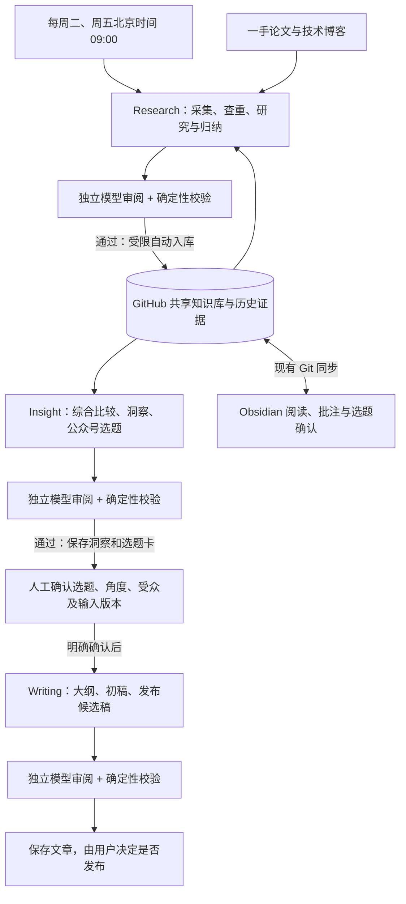

# ResearchDesk 三 Agent 总体架构

- 版本：0.3；修订日期：2026-10-19。
- 状态：**Research 与 Insight 正在分阶段验证测试闭环；未启用自动任务，不启动 Writing，不连接公众号发布**。
- 实施进度：已有[离线骨架](offline-research.md)、[真实资料采集测试](real-source-collection.md)和[本地会员真实研究与独立审阅](local-membership-analysis.md)。[配置驱动的 Research 批次闭环](configurable-research-batch.md)已通过一篇论文摘要与一篇博客节选的真实验收，共 4 次请求，独立审阅均通过，计划中断后补跑与完整缓存补跑均未重复调用；[验收记录](../reports/test/agent-memory/research-batches/configured-research-20261019/acceptance.md)只在测试区。[Insight 测试闭环](insight-agent-test.md)也已通过[真实验收](../reports/test/agent-memory/insight-runs/insight-agent-memory-20261019/acceptance.md)：两份已审阅 Research 与五份显式历史基线生成综合报告、2 条洞察和 2 张待确认选题卡，独立模型审阅通过；4 次请求含一次修订、语法规范化及独立格式确认，补跑未增加调用。全部产物只在测试区；人工确认入口、Writing、自动正式入库及定时任务尚未实现或启用。
- 目标：构建长期运行的 AI 技术研究与内容创作系统，持续收集一手资料、积累研究证据、发现技术变化，并为微信公众号提供可追溯的选题与文章。
- 基础：沿用 Markdown、YAML、GitHub 与 Obsidian；不引入数据库或复杂 Agent 框架。

## 1. 最终系统与当前边界

系统每周两次自动执行“发现资料 → 研究与归纳 → 独立审阅后入库 → 跨历史综合 → 洞察与公众号选题 → 独立审阅”，再由用户明确确认选题、角度与受众，才启动 Writing 生成大纲、初稿和发布候选稿。每轮利用此前积累的资料、判断和待解问题。新研究应说明它补充、支持或挑战了哪些历史结论，而不是只形成孤立摘要。技术趋势须有跨资料、跨时间的证据，不能凭单篇论文或同一产品的多篇博客下结论。

Research、Insight、Writing 是三个业务角色；它们可以由受控脚本分阶段调用模型完成，不要求常驻进程、多 Agent 对话或自行决定工具权限。独立审阅模型是三个角色共用的质量能力，不另设第四个业务 Agent。

目前已手动验证“来源 → 报告 → 洞察 → 文章”链路，并实现来源采集、本应用官方会员授权和 YAML 驱动的一篇论文、一篇博客研究批次。当前进入 [Insight 测试闭环](insight-agent-test.md)：对通过真实独立审阅的 Research 结果与历史基线进行跨资料综合，生成报告、1–2 条洞察和待人工确认的公众号选题，全部只写测试目录。正式自动入库、选题确认入口及 Writing 执行属于后续阶段；当前没有 Actions 配置，会员凭据仅存于仓库与 Obsidian Vault 之外。

## 2. 三个业务角色

| 角色 | 输入与职责 | 输出及目录归属 |
| --- | --- | --- |
| **Research Agent** | 从主题配置与白名单来源发现资料；核实原文、身份与版本；研究方法、主张、证据及局限；与历史研究关联；识别新版本和冲突。后续可跨资料综合比较。 | `sources/papers/`、`sources/blogs/` 保存单来源记录；`reports/` 保存综合研究报告；`reports/research-runs/` 保存执行清单与独立更新建议。首个 MVP 暂不自动生成综合报告。 |
| **Insight Agent** | 读取已审阅来源与报告，自动比较技术机制、评测条件、反例和局限；识别共识、分歧、证据空白及待验证问题；检查新证据是否改变旧判断，并判断哪些发现适合公众号表达。历史人工资料须显式登记，不等同于本轮原文复核。 | `reports/` 保存跨来源综合报告；`insights/` 保存带引用的洞察、置信限制和研究问题；`articles/` 保存候选选题卡，列明价值、核心观点、角度、受众、支持来源及证据缺口。资料不足时允许没有选题；既有洞察的修订先保存独立建议。当前仅写对应 `test/<topic>/`。 |
| **Writing Agent** | 只接受用户已明确确认的选题及其版本，读取对应证据、报告和洞察；按确认的角度和受众生成大纲、初稿和发布候选稿，核对表达是否超出证据。 | `articles/` 分别保存大纲、初稿和发布候选稿；阶段之间使用新文件，不覆盖旧稿。没有确认、确认过期或输入变化时不启动写作；候选稿通过不等于授权发布。 |

`config/` 保存主题与后续任务配置，`workflows/` 保存规范、设计及验收流程；三 Agent 的日常运行无权修改这些配置、模板、校验器、`.obsidian/` 或 GitHub 权限。

研究方向来自 [research_topics.yaml](../config/research_topics.yaml)。首期启用 `agent-memory`；未来可扩展 Agent RL 等方向，共用身份、引用和保护规则，不按主题复制同一来源。

模型分析使用用户自己的官方 ChatGPT 会员授权，具体资格、实际可用模型与执行主机分别验收；当前用户已完成本地授权与两个不同模型的真实推理。采集、分析和 Git 发布解耦，GitHub 负责定时触发及记录任务，本地或符合条件的自托管执行器处理会员调用。临时 runner 的会员资格尚未验证，不能把本地成功推广为全部部署环境可用。各安装独立登录，不分发维护者凭据、不读取既有 Codex 或浏览器会话。[官方适用范围](https://developers.openai.com/siwc/token-sharing-open-source)、[自托管指南](https://developers.openai.com/siwc/token-sharing-open-source/self-hosted-vms)

面向开源时，将框架代码、公共示例配置、个人研究资料和仓库外授权 profile 分开。主题、来源、模型与预算通过 YAML 配置，用户无需修改调度代码即可建立自己的研究工作台。配置不能扩大程序的路径、权限或覆盖边界；配置变更需要维护者明确操作，模型无权自行修改。

新增方向使用独立目录：正式来源拟按 `sources/<papers|blogs>/<primary-topic>/`，报告、洞察、文章按各自的 `<primary-topic>/`；测试数据统一放各目录的 `test/<topic>/`。旧资料保持原位，多主题来源以一个主要目录和 `topics` 列表表达，不复制文件。当前目录及离线输出边界见[离线运行说明](offline-research.md)。

## 3. 共享知识与逐级证据

- **来源层 `sources`**：原文事实、作者主张与研究者推断分开；保留原始 URL、版本、阅读范围、支持结论的证据定位。来源身份遵循 [Schema](source-schema.md)及[去重维护规范](maintenance.md)。
- **报告层 `reports`**：以来源 ID 和文件链接说明比较依据，标明不同实验条件与可比性限制；不能把引用过的来源等同于已支持全部结论。
- **洞察层 `insights`**：链接具体报告和原始证据，说明支持、反例、不确定性及后续验证方法；推断须显式标识，避免在传播中变成事实。
- **文章层 `articles`**：链接洞察、报告并保留原文引用；通俗比喻、观点和表达不得制造原文没有的数据或因果关系。核心事实可逐级追溯至原文。

每项新产出写明所用输入文件、Git 基线、原文版本与证据散列；关联只指向已存在且核实的来源 ID 和文件。正式阶段只读取 `main` 中由清单确认 `accepted` 的产出；当前 Insight 隔离测试允许已核实真实独立审阅回执的 `test_accepted` Research 结果，不能据此认定正式入库。模拟、待处理或失败产物不作为既定结论输入。

现有人工入库的来源、报告、洞察和文章作为 `human_baseline` 单独登记路径、散列及来源，不修改旧文件或伪造模型审阅记录；它们与后续 `accepted` 自动产物均可作为研究输入。人工新增或修改的资料按只读校验更新基线登记，保留人工来源标识。全库身份查重仍覆盖所有来源，不因缺少机器审阅回执而跳过旧资料。

历史基线是既有判断，不能仅因传入新模型就升级为原文事实或独立验证。Insight 洞察必须关联至少两个不同的原始来源 ID，并说明支持关系、局限和待验证方法；多篇笔记引用同一原文只算一个来源，有产品或技术沿革关系的材料不自动构成独立验证。每轮综合应明确哪些旧判断得到有限支持、需要收窄或仍缺证据，材料有限时不强行归纳行业趋势。

GitHub 是共享资料与版本记录的主线，`main` 表示已正式入库的版本；Obsidian 保持现有 Git 同步，用于本地阅读、检索、批注与人工研究。GitHub 触发不依赖个人 Vault 在线；若选用本地会员执行器，该主机必须在线才能分析，离线时保留任务并在恢复后补跑。使用长期自托管主机的可用性需要单独验收，现有 Obsidian 同步设置保持原样。

## 4. 共用审阅与自动入库

正常研究、综合、洞察及候选选题不设置人工逐篇审阅门槛。生成完成后，先执行确定性校验，再由独立审阅模型核查，全部通过后经受限 PR 自动合并到 `main`；两类检查互不替代。人工确认是从选题进入 Writing 的业务决策，不能用研究审阅通过或定时任务授权替代。

| 关卡 | 职责与通过条件 |
| --- | --- |
| 确定性校验 | Schema、身份与关联、路径白名单、创建约束、证据定位、散列、预算及候选完整性全部满足；不靠模型判断文件是否可以覆盖。 |
| 独立模型审阅 | 与生成模型使用**不同 model ID、独立上下文和审阅提示词**；读取候选全文、同一原文证据包、相关历史输入和差异，检查事实、引用、推断边界、覆盖范围、重复及结论支持程度。 |
| 发布前复核 | 审阅绑定的候选、证据、基线和当前拟合并内容一致；重新核对最新 `main` 的身份与路径，所有必需仓库检查通过。 |

启用前必须配置生成模型和审阅模型的明确 ID、提示词版本与费用限制。模型相同、审阅模型缺失、上下文不足、调用失败或审阅格式不合法时，进入待处理队列；不能回退为生成模型自审，也不能将缺席审阅当成通过。

审阅返回结构化 `pass / revise / reject / blocked`，包含问题列表、严重程度、对应主张及证据 ID、可操作修改建议和限制。严重事实错误、伪造引用、证据不足却声称完整研究等情况不得 `pass`。

- `pass`：候选满足当前门槛，可进入发布前复核。
- `revise`：仅允许生成端修订 **1 次**，重新执行确定性校验并交同一独立审阅角色完整复审；仍未通过则终结当前分析轮次。跨批保留已用修订次数和原因，同一证据版本不能换批次重置；新证据、版本或已满足的明确恢复条件才允许重新规划。
- `reject`：当前候选不入库，持久化身份、拒绝原因和证据版本；同一内容不在下个定时批次自动换 ID 重做。
- `blocked`：证据、身份、权限、预算或运行条件不足；保留已完成内容与恢复条件，条件满足后按清单补跑。

审阅回执至少绑定候选文件及内容散列、原文证据包散列、输入文件及基线 commit、生成与审阅 model ID、提示词版本和结果。候选或证据变化使回执失效；基线变化先重新查重、校验关联及保护边界，并重新审阅，不能沿用旧的绿色结果。

上述失效规则针对待发布候选；历史 `accepted` 资料不会因 `main` 新增无关文件而全部失效。新证据对旧判断的影响通过后续独立更新材料表达。

审阅通过只表示满足已定义的质量门槛，不能保证事实绝对正确。证据不足时缩小主张或停止入库；后续新证据可通过独立更新建议纠正既有判断。

自动入库使用 `codex/` 分支与可审计 PR，发布步骤只接受通过检查的确切提交。遵守分支保护、必需检查和仓库合并规则；若规则要求人工批准或权限不支持自动合并，则标记阻塞，不静默改规则、绕过检查、强推或直接推送 `main`。此类异常处理不等于正常研究必须人工审阅。

## 5. 人工笔记与历史判断保护

**所有已有文件均不可由三 Agent 覆盖**，包括机器人过去创建而后来被人工编辑的文件。已有正文、人工笔记、状态、主题、关联和既有文章版本一并保留；来源更新、新结论或审阅通过都不能放宽该限制。

新增来源严格使用当前 Schema，以预留 UUID v4 创建，初始化 `status: inbox`；它保留人工阅读状态的既有含义。模型审阅结果另记运行清单，不新增 Frontmatter 字段，不自动改成 `analyzed`。正文标明自动生成及审阅范围，人工笔记章节留空。

发现已有来源新版本、旧结论需调整或旧稿需修订时，创建带原路径、旧散列、新证据与建议差异的独立更新材料。更新建议本身经审阅后可自动入库；将它应用到旧文件仍需显式人工操作，不能把“自动接纳建议”解释成覆盖授权。

并发期间 `main` 新增同身份资料、已有文件变化或机器人分支被人工编辑，均先停止当前发布并保全两侧内容。禁止自动解决笔记冲突；相同机器散列的已存产物可复用，但不重写。

## 6. 触发、运行与失败恢复

Research 拟在**每周二、周五北京时间 09:00**运行；UTC cron 为 `0 1 * * 2,5`，计划时间不保证准点。每批通过的研究入库后自动触发综合与 Insight，完成独立审阅后保存洞察和候选选题；同一批次产物没有变化时不重复分析。未来手动入口用于验收、恢复和历史区间补跑。Writing 只由用户的有效选题确认触发，不随研究定时运行；当前不创建或启用任何调度。

每批使用持久化 YAML 清单和 Git 分支记录固定时间窗、身份键、预留 ID、输入/证据散列、阶段、调用预留、费用、输出和处理决定。不以临时 runner、缓存或 artifact 作为唯一状态，不引入数据库。

- 先持久化身份与调用额度再发请求；生成、审阅、一次修订及复审、网络重试与恢复重试共用批次/月度预算。关闭隐式无限重试，不明计费用量按预留上限消耗处理。
- 单个资料失败不阻止健康项独立通过审阅与入库；批次回执明确部分成功、未完成项及恢复条件，不能将其标成全部成功。
- 补跑沿用原时间窗、UUID 和已保存结果，只继续未完成阶段；已通过回执仅在绑定内容仍一致时复用。待处理队列区分可重试、拒绝、冲突与额度延后。
- 来源完整扫描游标与资料处理状态分开；只有扫描完整性和待办持久化并合并后才推进该来源游标。失败、漏跑和分页截断按旧游标重叠补扫，不能跨过未覆盖区间。
- 调度、补跑和发布共享并发约束；单个内容阻塞项归档原因与身份后，让其他健康项继续。权限或合并配置故障使整个发布通道不可用时，先恢复发布，暂停新增付费研究，避免积压和重复调用。

模型只接收受限证据文本，不持有仓库写入工具或授权凭据；抓取资料中的指令不具备权限。未来分析客户端按官方会员授权机制保护自己的凭据，不复用浏览器 Cookie 或现有 Codex session；持久化、创建 PR 与合并步骤不持会员凭据，单独授予最小仓库权限，并执行路径白名单检查。

## 7. 选题确认与写作边界

选题卡必须给出稳定 ID、版本或内容散列、核心观点、写作角度、目标读者、主要依据、证据缺口和推荐范围。用户可在后续明确的确认入口接受或调整这些内容；仅编辑笔记、阅读选题、模型返回 `pass` 或没有回复均不是确认。

当前 Insight 测试由程序将选题状态固定为 `proposed`、`approval_required: true`、`writing_started: false`；模型不能将候选标记为已确认。本阶段没有确认入口，不生成大纲、初稿或候选稿，也不因测试审阅通过而启动 Writing。

确认记录由受信任程序根据用户明确操作创建，绑定选题卡及证据输入的路径、散列、角度和受众。模型不能创建或批准自己的确认记录。Writing 启动前再次核对绑定内容；选题、角度、受众或证据发生实质变化时，需要新确认，不能将旧确认套用到新主题。确认与文章版本一并保留，允许用户撤回尚未执行的确认。

首次写作授权覆盖该选题下的大纲、初稿、有限修订及发布候选稿，具体阶段限制由后续 Writing MVP 明确；它不授予公众号发布权限。发布始终由用户另行决定，当前不开发发布接口。

## 8. 分阶段实施与验收

1. **配置驱动的 Research 测试批次**：已验收 YAML 主题、来源、模型和预算下的一篇论文摘要与一篇博客节选，接通真实会员研究、独立审阅、失败补跑与测试回执，既有资料保持不变。
2. **综合研究、Insight 与选题测试**：已用两份已审阅 Research 与五份显式历史基线，完成跨来源综合报告、2 条洞察和 2 张待确认选题卡的真实独立审阅，并验证中断恢复与缓存补跑不追加请求。证据不足、无选题、拒绝、预算及门禁失败另由离线测试覆盖；全部结果只写测试目录，不将模拟场景冒称真实模型验收。
3. **正式运行与入库**：接通持久任务、固定扫描窗口、受限 PR 自动合并与恢复；验证授权续期、主机在线和 GitHub 规则，另获授权后启用每周两次 Research 与后续 Insight 调度。
4. **选题确认与 Writing**：实现可审计的人工确认，再按确认的版本生成大纲、初稿和候选稿，逐级引用与审阅；公众号发布继续作为独立授权能力。
5. **开源交付**：从配置边界开始保持可移植性，再补齐初始化、部署说明、许可证与贡献约定；示例不包含个人凭据、账户信息或研究库私有内容。

完整实施验收须覆盖：重复与新版识别、人工编辑保全、生成与审阅模型隔离、证据不足拒绝、候选变化使审阅失效、预算中断、部分失败补跑、PR 合并规则阻塞、Obsidian 同步、自动选题和绑定版本的人工确认。已验证的范围包括离线闭环、真实采集及[单篇摘要会员分析](local-membership-analysis.md)；Research 与 Insight 批次实时状态分别以[配置驱动说明](configurable-research-batch.md)、[Insight 测试说明](insight-agent-test.md)及实际回执为准，不表示自动 PR、Writing、人工确认或调度已经实现。
